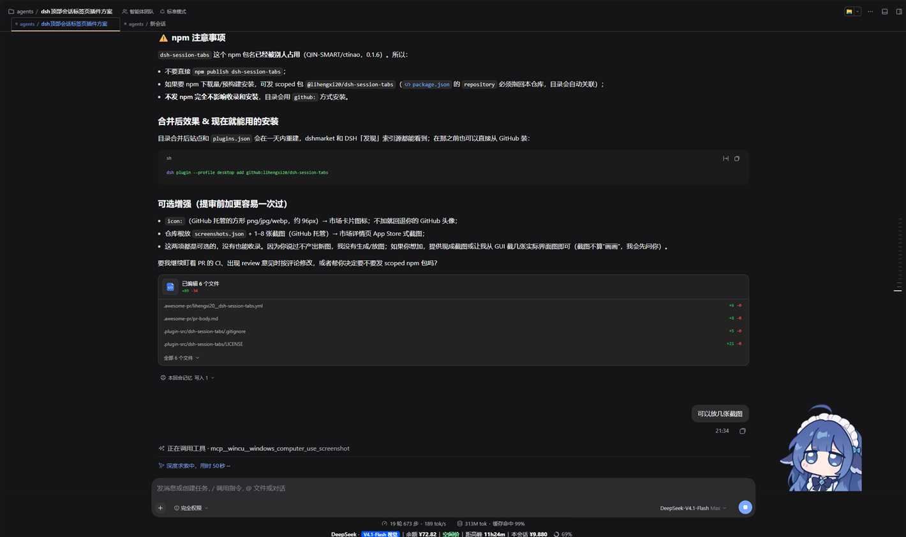
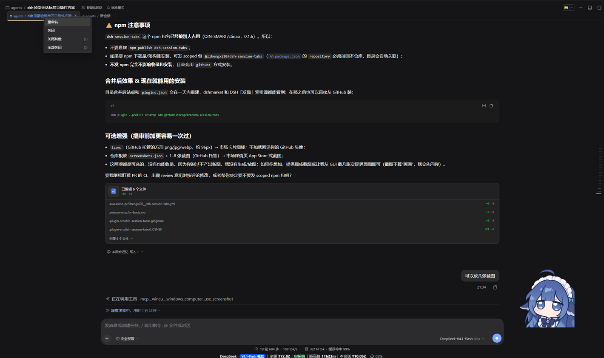
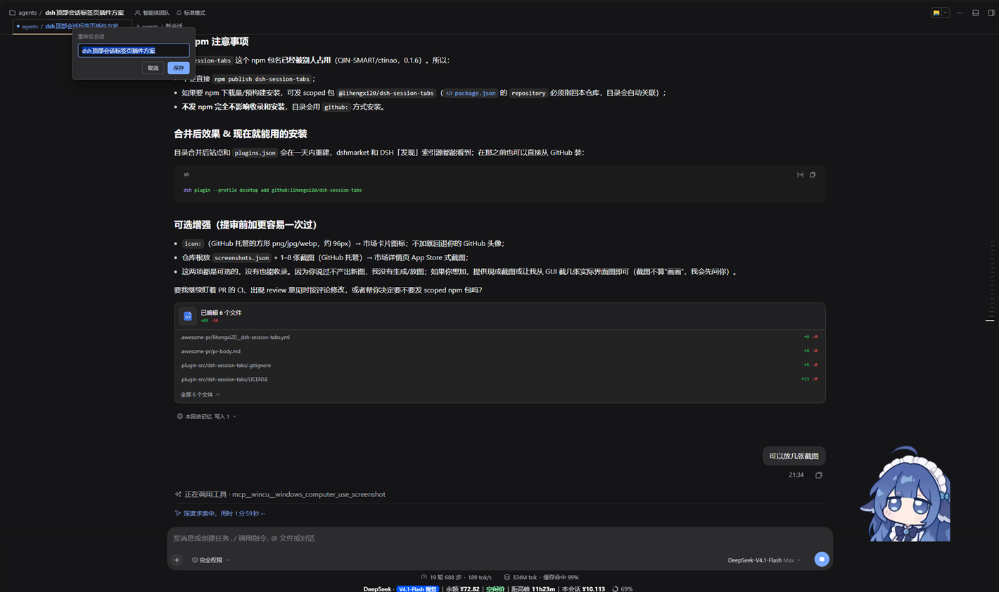

# dsh-tabs

DSH（DeepSeek Harness）Web GUI 的**顶部会话标签页**插件：在会话头部下方加一行会话标签，像浏览器标签一样管理打开过的会话。

> GitHub 仓库：`lihengxi20/dsh-session-tabs` · npm 包名：`@lihengxi20/dsh-tabs`（同一份代码）。

> **English summary** — A session-tab bar for the DSH web GUI: open sessions as tabs, switch / close / rename them, with `workspace / title` labels and a persisted tab list. Published as `@lihengxi20/dsh-tabs`; plugin-only, no DSH core changes.

## 截图







## 功能

- **单/多会话**：只有一个会话时也显示一个标签；多会话时按打开顺序排列，从侧边栏、搜索或新建会话打开时自动加入。
- **标签文案**：`工作区 / 会话标题`；工作区取侧边栏的工作区标题（缺省回退目录名），空白会话显示 `工作区 / 新会话`。
- **切换与关闭**：点击切换；悬停出现 `×`（单个标签也可关闭）；中键点击关闭。关闭只移除标签，不归档、不停止任务；关闭最后一个标签会回到「未选中会话」的空白页。
- **右键菜单**：重命名 / 关闭 / 关闭其他 (n) / 全部关闭 (n)；重命名走 Host 的 `session/rename`，空白会话禁用。
- **状态圆点**：运行中（蓝/脉冲）、等待审批或回答（橙）、完成未读（绿）。
- **持久化**：标签顺序、活动标签、标题与工作区缓存存在浏览器 `localStorage`（键 `dsh-session-tabs.v1`），刷新/重开客户端后恢复。
- **跟随主题**：全部使用 DSH 主题变量，深浅色、字体大小自动适配。

标签是导航状态：DSH 同一时刻仍只渲染一个会话，后台任务照常运行。

## 兼容性

- 面向 **DSH 0.2.2-rc.1**（desktop profile）开发并实机验证。
- 依赖会话头部的 `conversation.header.leading`、`conversation.session.header.actions` 槽位，以及 `sessions` / `uiWorkspace` / `uiSession` 客户端服务；DSH 升级后请按 README 的验收清单复验，槽位不可用时插件会降级为不显示标签，不影响会话页面。

## 安装

通过 DSH 自带插件管理器添加：

```sh
# npm
dsh plugin --profile desktop add @lihengxi20/dsh-tabs

# 或直接从 GitHub 仓库安装（始终跟最新代码）
dsh plugin --profile desktop add github:lihengxi20/dsh-session-tabs
```

`--profile` 换成目标 profile（如 `web`）。装好后在 **设置 → 插件** 中启用/禁用它；插件市场（dshmarket）收录后也可以直接在市场里搜索安装。

## 开发

- 无需构建：`lib/client.js` 是真实的浏览器 CJS bundle，`lib/index.js` 是让 Loader 拥有条目的 host 半侧占位。
- 本地开发可直接以目录方式安装：

```sh
dsh plugin --profile desktop add link:C:/path/to/dsh-session-tabs
```

- 修改 `lib/client.js` 后，在插件管理器里禁用再启用该条目即可热重载浏览器端，无需重启 DSH。

## 数据与隐私

插件不发起网络请求、不上报遥测；只在浏览器 `localStorage['dsh-session-tabs.v1']` 保存标签 id、标题缓存与活动标签。

## License

[MIT](./LICENSE)
